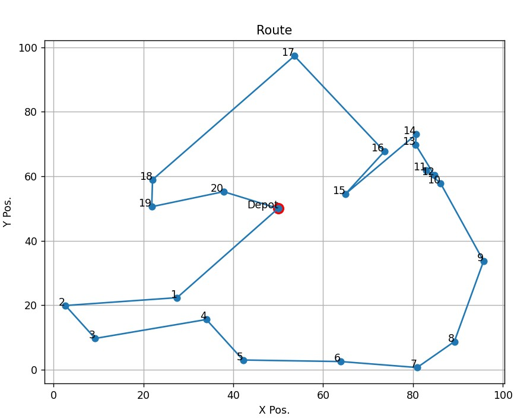
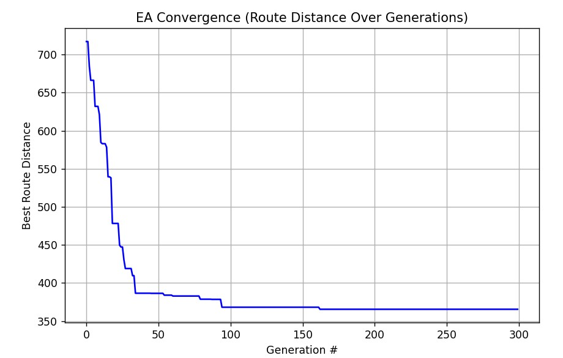

# CISC455-project

This is the implementation for a postal truck delivering packages. The evolutionary algorithm implemented is designed to minimize the route distance, allowing the truck to deliver to every location in the quickest time possible.

## Code

`postalRoute.py`

- defines PostalDeliveryEA which contains evolutionary algorithm for postal truck delivery route

`visualization.py`

- generates visualizations of EA algorithm in action

1. plots numbered route of best route followed based on route distance
2. plots bar graph of route distance over generations

`testEA.py`

- contains 3 tests for PostalDeliveryEA

1. Comparing EA with a baseline greedy nearby-neighbour heuristic
2. Scaling the EA on larger problems
3. Testing different mutation rates and comparing convergence

## Example

This is an example route generated with 20 stops and a mutation rate of 0.05.

